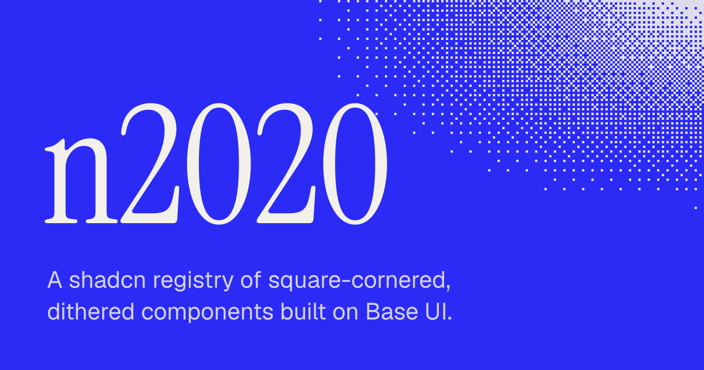

# n2020

[](https://ui.n2020.com)

[](LICENSE)

A shadcn registry of square-cornered, dithered components for dashboards. The components use [Base UI](https://base-ui.com) and Tailwind CSS v4.

The docs and live examples are at [ui.n2020.com](https://ui.n2020.com).

## What is in it

- The shadcn components, restyled. They keep the shadcn props and exports, so code written for shadcn works with them.
- Components that shadcn does not have: `chart-card`, `data-table`, `data-table-pagination`, `date-range-picker`, `dither`, `page-header`, `sky`, and `stat`.
- Blocks, which are whole pages built from the components: a dashboard and a login page.
- A theme with light and dark tokens, no rounded corners, and three fonts: Geist, Geist Mono, and Instrument Serif.
- Docs that an agent can read. The site serves [`/llms.txt`](https://ui.n2020.com/llms.txt), and every docs page has a Markdown version at the same address with `.md` added.

## Quick start

You need a React project with Tailwind CSS v4 and shadcn initialised with the Base UI library. n2020 does not support Radix. To create a project that meets these requirements, run this command:

```bash
pnpm dlx shadcn@latest init -b base
```

Install the theme first. The components read their colours, fonts, and radius from the theme.

```bash
pnpm dlx shadcn@latest add https://ui.n2020.com/r/theme.json
```

Then install a component. Each page in the docs shows the command for its component.

```bash
pnpm dlx shadcn@latest add https://ui.n2020.com/r/button.json
```

The CLI writes the component to your `components/ui` directory and installs its dependencies, which include the other n2020 components that it uses.

```tsx
import { Button } from "@/components/ui/button";

export function Example() {
  return <Button variant="outline">Save</Button>;
}
```

### Use a shorter name

To install with `@n2020/<name>` instead of the full address, add the registry to your `components.json`:

```json
{
  "registries": {
    "@n2020": "https://ui.n2020.com/r/{name}.json"
  }
}
```

```bash
pnpm dlx shadcn@latest add @n2020/stat @n2020/data-table
```

## Repository

| Path | Contents |
| --- | --- |
| `registry/n2020/ui` | The shadcn components, restyled |
| `registry/n2020/components` | Components that shadcn does not have |
| `registry/n2020/blocks` | Whole pages built from the components. The site shows each block at `/view/<name>` |
| `registry/n2020/hooks`, `registry/n2020/lib` | The `use-mobile` hook and the `cn` utility. The registry does not publish them, because a shadcn project has its own copies |
| `registry/n2020/examples` | Examples that the docs pages render. The registry does not publish them |
| `registry/n2020/theme.css` | Tokens, fonts, and scrollbar styles |
| `content/docs` | The docs pages |
| `src` | The docs site, built on Fumadocs and TanStack Start |
| `registry.json` | The item list. `scripts/build-registry.mjs` generates it |

## Develop

You need Node.js 22.12 or later and pnpm 10.

```bash
pnpm install
pnpm dev
```

`pnpm dev` starts the docs site at `http://localhost:3000`.

| Command | Result |
| --- | --- |
| `pnpm registry:build` | Writes `registry.json` and builds the items into `public/r` |
| `pnpm build` | Builds the registry and the site |
| `pnpm lint` | Runs Biome |
| `pnpm types:check` | Runs TypeScript |
| `scripts/test-install.sh` | Installs every item into a new shadcn app and builds that app |
| `pnpm run deploy` | Builds and deploys to Cloudflare Workers |

### Add a component from shadcn

1. Run `pnpm shadcn add <name>`. The CLI writes the file to `registry/n2020/ui`.
2. Edit the file to match the theme. Use the other files in `registry/n2020/ui` as the reference for borders, shadows, and corners.
3. Run `pnpm biome check --write registry`.
4. Add an example to `registry/n2020/examples` and a page to `content/docs/components`.
5. Run `pnpm build`.

Do not run `pnpm shadcn add` for a component that the registry already has. The CLI replaces the file and removes the n2020 changes. To take an upstream fix, read the change in shadcn and edit the file.

### Add a custom component

1. Create the file in `registry/n2020/components`. Import other registry files through `@/registry/n2020/...`.
2. Add an example and a docs page.
3. Run `pnpm build`. The build adds the component to `registry.json` and reads its dependencies from its imports. It fails if a file calls a hook or passes an `on*` prop without `"use client";` at the top.

### Host your own copy

Set `url` in `registry.config.json` to the address that serves your site. The install commands in the docs and the dependencies between items use this address.

## Contributing

Report a bug or ask for a component in [the issues](https://github.com/marcinkonwiak/n2020-ui/issues). Before you open a pull request, run `pnpm lint`, `pnpm types:check`, and `scripts/test-install.sh`.

## License

[MIT](LICENSE). The files in `registry/n2020/ui` started as [shadcn/ui](https://ui.shadcn.com) components, which are also under the MIT license.
